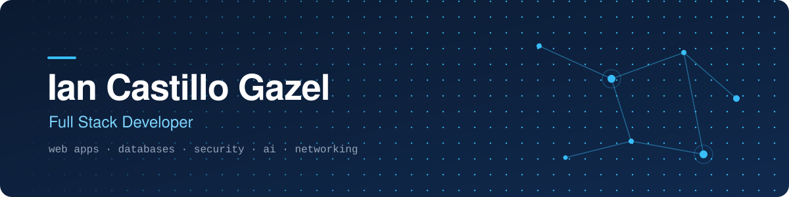

<picture>
  <source media="(prefers-color-scheme: dark)" srcset="./assets/banner-dark.svg">
  <source media="(prefers-color-scheme: light)" srcset="./assets/banner-light.svg">
  
</picture>

  <a href="#featured-projects"><b>Projects</b></a>&nbsp;&nbsp;·&nbsp;&nbsp;
  <a href="#tech-stack"><b>Stack</b></a>&nbsp;&nbsp;·&nbsp;&nbsp;
  <a href="#certifications--training"><b>Training</b></a>&nbsp;&nbsp;·&nbsp;&nbsp;
  <a href="#contact"><b>Contact</b></a>

## About me

I'm a full stack developer who builds web applications end to end: the interface, the API behind it, the data model and the deployment. Most of my work starts from a real need, like a civic safety app, a restaurant management system or the owners' portal of a residential condominium.

- **Full stack.** React, Next.js and TypeScript on the front; Node.js/Express, FastAPI and Spring Boot on the back.
- **Data.** Relational and document databases: PostgreSQL, MongoDB and Oracle, with Prisma, SQLAlchemy and JPA.
- **Security first.** JWT auth, email verification and 2FA, password hashing, rate limiting, secure headers, and client-side AES-256-GCM encryption.
- **Applied AI.** Automated content moderation with Google Cloud Vision and the Perspective API, plus a rule-based assistant in Python.
- **Infrastructure.** Networking and IT training (CCNA, IT Essentials, Linux) that shapes how I deploy and secure what I build.

## Featured projects

### [COMET](https://github.com/Castillo2308/Comet) · civic safety platform
A progressive web app where residents report incidents, mark dangerous areas, follow bus routes, take part in a community forum and get alerts from the municipality and police. Community posts go through automated image and text moderation before they're published. *Team project.*

`React` `TypeScript` `Vite` `Express` `PostgreSQL (Neon)` `MongoDB` `Google Maps` `Cloud Vision` `Perspective API` `JWT` `PWA`
&nbsp;→&nbsp; [Live demo](https://cometorg.vercel.app) · [Code](https://github.com/Castillo2308/Comet)

### [MercadoLibre Clone](https://github.com/Castillo2308/MercadoLibre) · marketplace
A marketplace modeled on MercadoLibre: product catalog and search, deals, cart, favorites, buyer and seller messaging, orders and sales history. Sign-up includes email verification, password reset and two-factor login.

`Next.js` `TypeScript` `Prisma` `PostgreSQL (Neon)` `Tailwind CSS` `Zustand` `Nodemailer`
&nbsp;→&nbsp; [Live demo](https://mercado-libre-ashen.vercel.app) · [Code](https://github.com/Castillo2308/MercadoLibre)

### [DineMaster](https://github.com/Castillo2308/DineMaster-Frontend-Backend) · restaurant management system
Management for a restaurant chain: branches and tables, reservations, menu, kitchen orders, payments, a loyalty program, reports and email notifications. It's a REST API with role-based authentication and a React dashboard.

`Python` `FastAPI` `SQLAlchemy` `PostgreSQL` `JWT` `React` `Vite` `Tailwind CSS` `Recharts`
&nbsp;→&nbsp; [Code](https://github.com/Castillo2308/DineMaster-Frontend-Backend)

### [Portal El Doral](https://github.com/Castillo2308/portal-el-doral) · condominium owners' portal
A portal for a residential condominium with community information, finances and projects, plus individual statements for 62 units. Each statement is encrypted with AES-256-GCM using a key derived from that unit's password (PBKDF2-SHA256), so a static host can serve it safely. Deploys run automatically on every push.

`React` `Vite` `Web Crypto API` `GitHub Actions` `GitHub Pages`
&nbsp;→&nbsp; [Live site](https://castillo2308.github.io/portal-el-doral/) · [Code](https://github.com/Castillo2308/portal-el-doral)

<b>More projects</b>

 

| Project | What it is | Stack |
|---|---|---|
| [Recipe Management System](https://github.com/Castillo2308/Sistema-recetas-cocina) | REST API and web client for recipes, ingredients, image uploads and voting | Node.js, Express, MongoDB, JWT, Multer |
| [React Auth](https://github.com/Castillo2308/React-Login-y-Registro) | Sign-up and login with protected routes and a hardened API | React, TypeScript, Express, MongoDB, JWT |
| [RutaPro](https://github.com/Castillo2308/Chatbot-Rutapro) | Driving theory learning app with quizzes, traffic signs and an assistant | React, TypeScript, Python |
| [Videoclub](https://github.com/Castillo2308/VideoclubIan) | Video rental management with movies, actors and tapes | Java, Spring Boot, JPA, Oracle, Thymeleaf |
| [React Native App](https://github.com/Castillo2308/ProyectoPersonalReactNative) | Mobile app with stack navigation and local storage, also built for web | React Native, TypeScript |

## Tech stack

| Area | Tools |
|---|---|
| **Languages** |  |
| **Frontend** |  |
| **Backend** |  |
| **Databases** |  &nbsp;+ Oracle Autonomous DB |
| **Cloud & tools** |  |

**Security in practice:** JWT · bcrypt · 2FA · Helmet · rate limiting · input validation · AES-256-GCM / PBKDF2

## Certifications & training

| Area | Certifications and courses |
|---|---|
| 🌐 **Networking** | CCNA · Networking · IT Essentials |
| 🐧 **Systems** | Linux Essentials · Cloud Computing Fundamentals |
| 🧠 **Programming & AI** | Python Essentials · IBM AI Fundamentals · Web Development Fundamentals |

## Contact

Open to junior full stack, backend and web development roles, internships and freelance projects.

